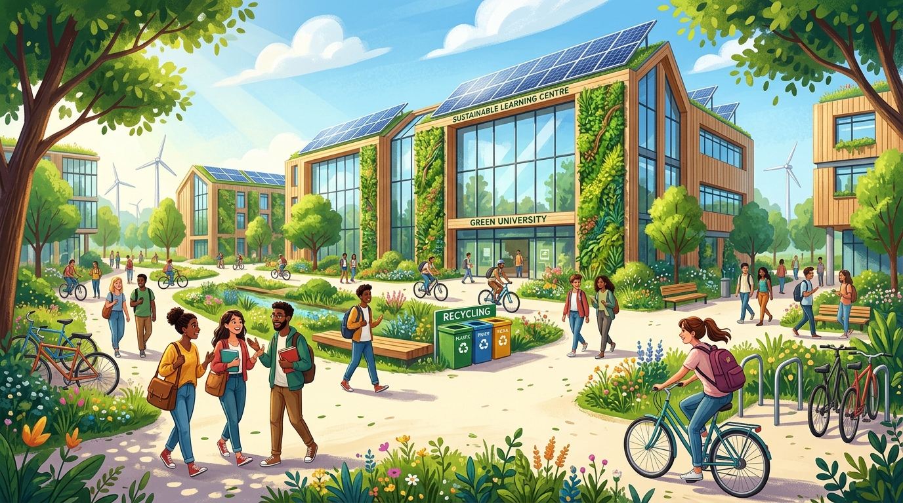

# Green Campus Awareness Bot 🌿 (EcoBot)

An AI-powered environmental awareness web application built for college students, teachers, and campus staff to promote sustainable habits, waste reduction, water and energy conservation, tree plantation, and collective climate action.



---

## 🌟 Key Features

### 1. 🤖 AI-Powered Chatbot (EcoBot)
- Answers environmental questions in clear, student-friendly language.
- Contextual guidance on recycling, composting, saving water and electricity, and minimizing single-use plastic.
- Quick-reply suggestion chips for common campus inquiries:
  - *How can I make my campus greener?*
  - *How can I save water in college?*
  - *Where should I dispose of plastic waste?*
  - *What is composting?*
  - *How can students reduce electricity consumption?*
- Conversation history tracking within active sessions.
- Typing indicator, copy response feature, and clear-chat capability.
- **Graceful Fallback Mode:** Runs seamlessly using a built-in semantic campus environmental knowledge base even if an OpenAI API key is not yet configured.

### 2. 🏆 Eco-Challenges & Gamified Action Tracker
- Daily and weekly eco-challenges for students and faculty:
  - Bring a reusable water bottle
  - Avoid single-use plastic today
  - Switch off lights and fans when leaving empty classrooms
  - Separate wet and dry waste at cafeteria bins
  - Participate in a campus cleanliness drive
  - Plant and care for a tree / sapling
  - Zero-emission commute (walk or cycle)
  - Conduct a dorm or lab energy audit
- Live progress bar, accumulated Eco-Points, and toggleable completion states.
- Interactive **"Log Campus Eco-Activity"** form that persists real student contributions into the database.

### 3. 💡 Categorized Green Campus Tips
- Searchable directory of environmental tips spanning six core categories:
  - **Water Conservation** (leak reporting, mindful washing)
  - **Energy Efficiency** (phantom loads, AC optimization)
  - **Waste Management** (twin-bin segregation, composting, zero-plastic cutlery)
  - **Air Quality** (anti-idling zones, indoor air-filtering plants)
  - **Biodiversity & Trees** (native tree planting, pollinator pockets)
  - **Sustainable Transportation** (campus cycling, carpooling)
- One-click copy/share action for social and student group sharing.

### 4. 📊 Sustainability Dashboard & Impact Analytics
- Live counters for tips shared, activities recorded, and challenges completed.
- Interactive **Chart.js** visualizations:
  - **Activity Category Breakdown** (Doughnut Chart)
  - **Cumulative Resource Conservation Estimates** (Bar Chart)
- Live feed of recent activities logged by campus members.
- Transparent disclaimer stating that metric figures are demonstration models for campus environmental awareness.

### 5. ⭐ Community Feedback System
- Interactive 5-star rating selector with real-time feedback.
- Categorized suggestion submission (Chatbot Accuracy, Campus Ideas, UI Experience, Challenge Ideas).
- Live community review feed displaying campus testimonials.

---

## 🛠️ Technology Stack

- **Frontend:** HTML5, CSS3 (Custom nature theme, glassmorphism, micro-animations), JavaScript (ES6+), Bootstrap 5.3.3, Bootstrap Icons, Chart.js.
- **Backend:** Python 3.10+ with Flask.
- **AI Integration:** OpenAI API (`gpt-4o-mini` configurable via environment variables) with intelligent local fallback knowledge engine.
- **Database:** SQLite (`greencampus.db`) with automatic table creation and initial seed data.

---

## 📁 Project Structure

```
e:\mini project\
├── app.py                     # Main Flask web application and REST API endpoints
├── database.py                # SQLite database management, schema, models, and seed data
├── ai_service.py              # OpenAI API integration + local environmental knowledge fallback
├── requirements.txt           # Python dependencies (Flask, openai, python-dotenv, requests)
├── .env.example               # Environment variables template
├── .env                       # Local environment configuration (ignored by git)
├── .gitignore                 # Excludes .env, *.db, and Python cache files
├── README.md                  # Comprehensive documentation and setup guide
├── static/
│   ├── css/
│   │   └── style.css          # Modern nature-inspired styling and responsive CSS
│   ├── js/
│   │   ├── app.js             # View navigation, toast alerts, status check, tip of the day
│   │   ├── chat.js            # Chatbot UI, typing indicator, quick suggestions, history
│   │   ├── challenges.js      # Challenge tracker, toggles, score progress, activity logging
│   │   ├── tips.js            # Categorized tip filtering and search
│   │   ├── dashboard.js       # Chart.js analytics, metric counters, recent activities feed
│   │   └── feedback.js        # Star ratings, feedback submission, community reviews
│   └── images/
│       ├── ecobot-avatar.jpg  # Mascot avatar (leaf & planet Earth character)
│       └── campus-hero.jpg    # Vibrant sustainable university illustration
└── templates/
    └── index.html             # Semantic responsive HTML5 application layout
```

---

## 🚀 Quick Start Guide

### 1. Prerequisites
Ensure you have Python 3.10 or higher installed. Check with:
```bash
python --version
```

### 2. Install Dependencies
Install all required libraries via pip:
```bash
pip install -r requirements.txt
```

### 3. Configure Environment Variables
Copy `.env.example` to `.env`:
```bash
cp .env.example .env
```
*(On Windows PowerShell: `Copy-Item .env.example .env`)*

Open `.env` and set your configuration:
```env
# OpenAI API Key (Optional for demo, required for live GPT models)
OPENAI_API_KEY=your_actual_openai_api_key_here

# Configurable OpenAI Model
OPENAI_MODEL=gpt-4o-mini

# Server settings
FLASK_PORT=5000
FLASK_DEBUG=True
SECRET_KEY=green_campus_bot_secure_session_key_2026
```

> **Note on AI API Key:**
> If you do not have an OpenAI API key or leave the placeholder, the application will automatically run in **Smart Campus Knowledge Engine (Demo Mode)**. The chatbot will answer all sustainability queries and suggested questions without errors.

### 4. Run the Application
Start the Flask development server:
```bash
python app.py
```

Open your browser and navigate to:
```
http://127.0.0.1:5000
```

---

## 🔒 Security & Best Practices

- **Zero Client-Side Keys:** The OpenAI API key is read solely on the server side via `os.getenv("OPENAI_API_KEY")`. It is never transmitted to the frontend or stored in browser storage.
- **Git Safeguards:** `.env` and SQLite `.db` files are strictly included in `.gitignore` to prevent sensitive credentials or data from being committed.
- **Input Validation:** User prompts and feedback submissions are validated and sanitized on both client and server before processing.

---

## 🧪 API Endpoints Reference

| Method | Endpoint | Description |
| :--- | :--- | :--- |
| `GET` | `/api/status` | Returns AI connection status and system info |
| `POST` | `/api/chat` | Sends message to EcoBot and returns response |
| `GET` | `/api/tips` | Retrieves tips (filters: `category`, `search`) |
| `GET` | `/api/challenges` | Returns all campus eco-challenges |
| `POST` | `/api/challenges/toggle` | Toggles completion of an eco-challenge |
| `GET` | `/api/activities` | Retrieves recent campus eco-activity logs |
| `POST` | `/api/activities` | Records a new green activity |
| `GET` | `/api/dashboard/stats` | Aggregated metrics & impact estimates |
| `GET` | `/api/feedback` | Community ratings and suggestions |
| `POST` | `/api/feedback` | Submits user rating and review |

---

## 🌿 EcoBot System Prompt Specification

EcoBot operates under strict guidelines:
> *“You are EcoBot, a friendly environmental awareness assistant for college campuses. Help students and staff adopt sustainable habits. Provide accurate, practical, easy-to-understand answers about recycling, water conservation, energy efficiency, biodiversity, pollution prevention, and climate change. Encourage responsible environmental behavior and suggest realistic campus activities. Never invent campus-specific facilities, recycling locations, statistics, or completed activities. If you do not know a campus-specific detail, ask the user or recommend checking with campus administration.”*

---

## 📜 License
Developed as a campus environmental education project. Open for extension and deployment across universities and schools worldwide. 🌍
